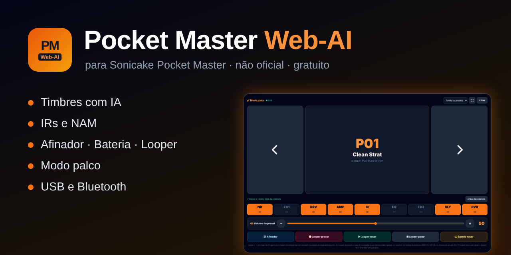

<h1 align="center">Pocket Master Web-AI</h1>

<b>Editor, AI tones, IRs, tuner, drums, looper and stage mode for the Sonicake Pocket Master pedal.</b> 
Runs in the browser, nothing to install · USB and Bluetooth · free · <b>unofficial</b>

  <a href="https://josepedrorocha-star.github.io/pocket-master-web-ai/"><b>▶ Open the app</b></a> ·
  <a href="README.md">Português</a> ·
  <a href="CHANGELOG.md">Changelog</a> ·
  <a href="https://github.com/josepedrorocha-star/pocket-master-web-ai/issues">Report a problem</a>

> The app has a **PT / EN** switch in the top-right corner.

## Features

- 🤖 **AI tone creator** — type the band, the song and your guitar; the AI builds a preset using only the pedal's models and parameters, explained step by step (Gemini, Groq, Claude, OpenAI with your key, or copy the request to any AI).
- 🎛️ **Full editor** — 9 blocks, chain order, preset volume, undo/redo, A/B compare, live changes on the pedal.
- 🔌 **USB and Bluetooth** — read, save (with name), rename, copy, import/export `.prst`, master volume and settings.
- 💾 **Full backup** — all 50 presets + settings in a ZIP; restore; factory reset with mandatory backup first.
- 🔊 **User IRs** — send a WAV to User IR 1–5, preview it and keep a library.
- 🧠 **NAM (TONE3000)** — checks Amp + Cab captures and asks the AI for a similar tone with the pedal's models.
- 🎸 **Tuner** — on the computer and the pedal's own tuner.
- 🥁 **Drums, looper, recorder and music** — on the computer (output through the pedal) and the pedal's own drums and looper.
- 🎤 **Stage mode** — big buttons: preset/setlist, block on/off, preset volume, tuner, looper, drums; Bluetooth page-turner pedals work.
- 📋 **Setlists and sharing** (code / QR) · 🌍 PT/EN · light/dark theme · installable, works offline.

## How to use

1. Open **<https://josepedrorocha-star.github.io/pocket-master-web-ai/>** in **Chrome** or **Edge** (desktop or Android).
2. Connect the pedal by **USB** (press **Connect**) or **Bluetooth**.
3. Make a **Backup** (top bar) before saving anything.

Requires Web MIDI (SysEx) / Web Bluetooth — not Safari or iPhone/iPad. Tested with firmware **1.3.3**.

## Privacy

Everything runs in your browser. Presets, settings and AI keys stay on your computer. Nothing is sent to the author; tone requests only go to the AI service you choose.

## Support ❤️

The app is free. If it helps you: [**PayPal**](https://www.paypal.com/paypalme/jprochapt) · **GitHub Sponsors** (coming soon). A ⭐ also helps!

## Disclaimer

Personal, independent and **unofficial** project, not affiliated with, approved or endorsed by Sonicake or Hotone. “SONICAKE” and “Pocket Master” are trademarks of their respective owners. Provided “as is”, without warranty — use at your own risk and always back up your presets first.

## Licence

© 2026 **jprocha-pt** — [MIT](LICENSE). Third-party components: [THIRD_PARTY_NOTICES.md](THIRD_PARTY_NOTICES.md).
