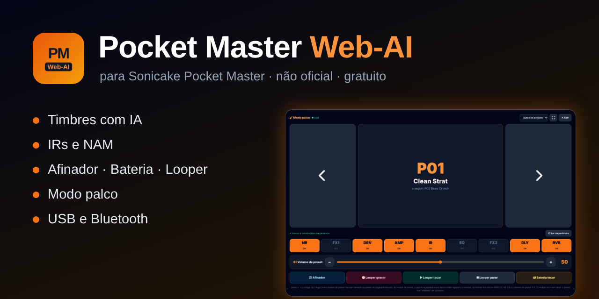
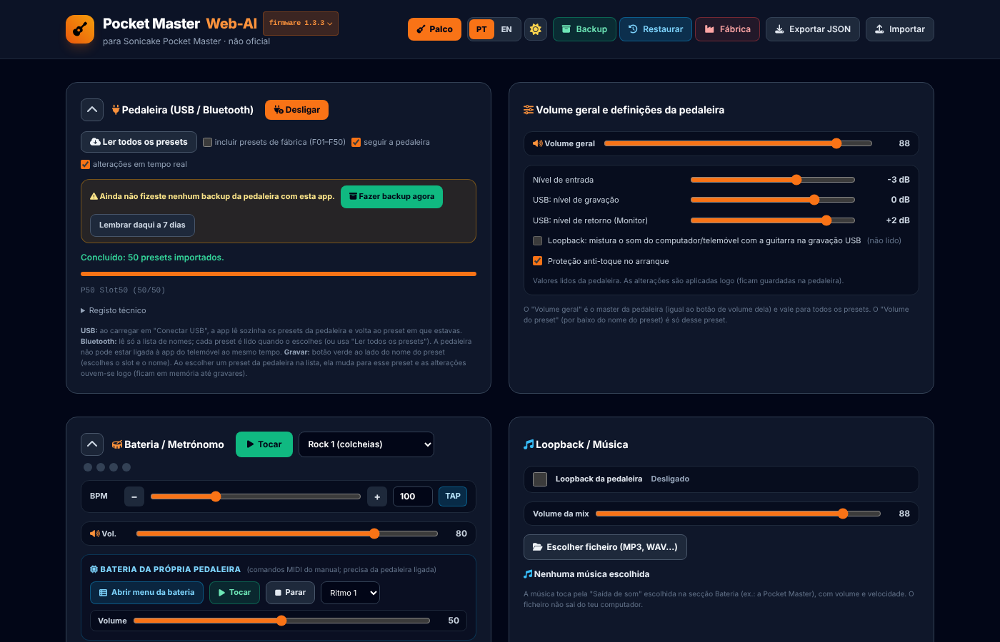
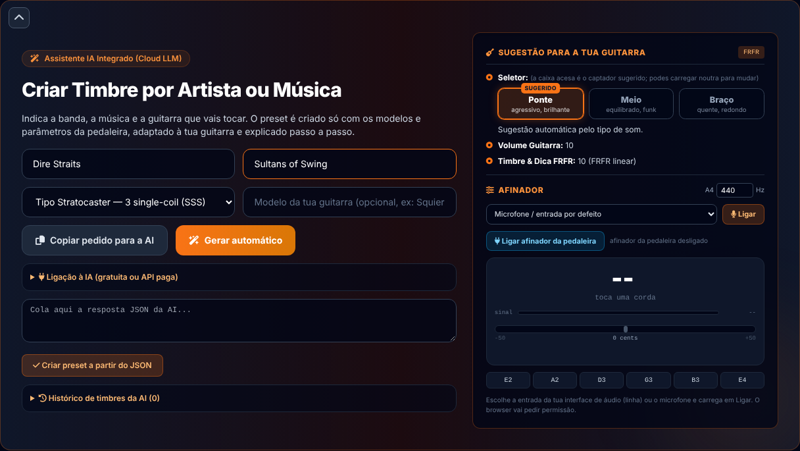
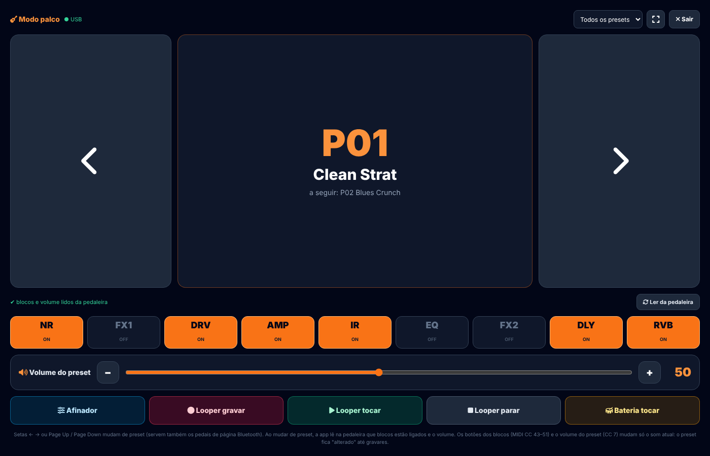
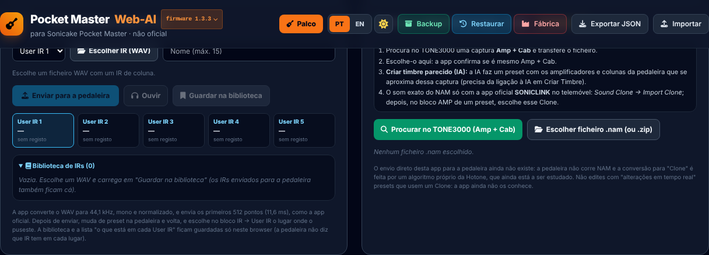
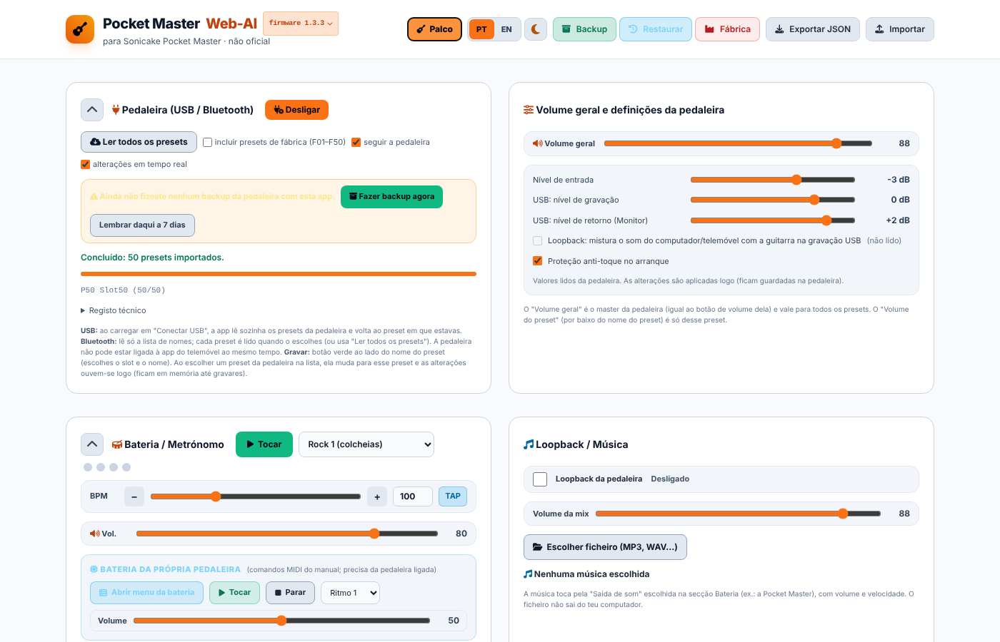
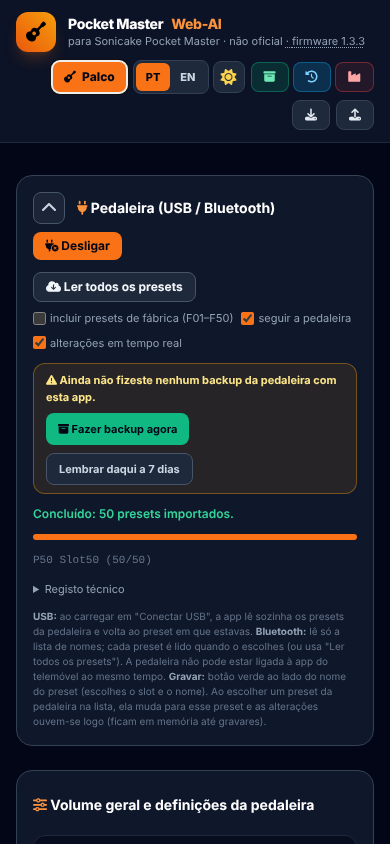

<h1 align="center">Pocket Master Web-AI</h1>

<b>Editor, timbres com IA, IRs, afinador, bateria, looper e modo palco para a pedaleira Sonicake Pocket Master.</b> 
Corre no browser, sem instalar nada · USB e Bluetooth · gratuito · <b>não oficial</b>

  <a href="https://josepedrorocha-star.github.io/pocket-master-web-ai/"><b>▶ Abrir a app</b></a> ·
  <a href="README.en.md">English</a> ·
  <a href="CHANGELOG.md">Novidades</a> ·
  <a href="https://github.com/josepedrorocha-star/pocket-master-web-ai/issues">Reportar um problema</a>

---

Features
🤖 AI tone creator — type the band, the song and your guitar; the AI builds a preset using only the pedal's models and parameters, explained step by step (Gemini, Groq, Claude, OpenAI with your key, or copy the request to any AI).

🎛️ Full editor — 9 blocks, chain order, preset volume, undo/redo, A/B compare, live changes on the pedal.

🔌 USB and Bluetooth — read, save (with name), rename, copy, import/export .prst, master volume and settings.

💾 Full backup — all 50 presets + settings in a ZIP; restore; factory reset with mandatory backup first.

🔊 User IRs — send a WAV to User IR 1–5, preview it and keep a library.

🧠 NAM (TONE3000) — checks Amp + Cab captures and asks the AI for a similar tone with the pedal's models.

🎸 Tuner — on the computer and the pedal's own tuner.

🥁 Drums, looper, recorder and music — on the computer (output through the pedal) and the pedal's own drums and looper.

🎤 Stage mode — big buttons: preset/setlist, block on/off, preset volume, tuner, looper, drums; Bluetooth page-turner pedals work.

📋 Setlists and sharing (code / QR) · 🌍 PT/EN · light/dark theme · installable, works offline.

---

How to use
Open https://josepedrorocha-star.github.io/pocket-master-web-ai/ in Chrome or Edge (desktop or Android).

Connect the pedal by USB (press Connect) or Bluetooth.

Make a Backup (top bar) before saving anything.

Requires Web MIDI (SysEx) / Web Bluetooth — not Safari or iPhone/iPad. Tested with firmware 1.3.3.

Youtube https://www.youtube.com/watch?v=sc-fBliGY4E

Privacy
Everything runs in your browser. Presets, settings and AI keys stay on your computer. Nothing is sent to the author; tone requests only go to the AI service you choose.

Support ❤️
The app is free. If it helps you: PayPal · GitHub Sponsors (coming soon). A ⭐ also helps!

Disclaimer
Personal, independent and unofficial project, not affiliated with, approved or endorsed by Sonicake or Hotone. “SONICAKE” and “Pocket Master” are trademarks of their respective owners. Provided “as is”, without warranty — use at your own risk and always back up your presets first.

Licence
© 2026 jprocha-pt — MIT. Third-party components: THIRD_PARTY_NOTICES.md.

---

## O que faz

| | |
|---|---|
| 🤖 **Criar timbre com IA** | Escreves a banda, a música e a tua guitarra, e a IA cria um preset só com os modelos e parâmetros da pedaleira, explicado passo a passo. Funciona com Gemini, Groq, Claude ou OpenAI (com a tua chave) ou copiando o pedido para qualquer IA. |
| 🎛️ **Editor completo** | Os 9 blocos (NR, FX1, DRV, AMP, IR, EQ, FX2, DLY, RVB), ordem da cadeia, volume do preset, desfazer/refazer e comparação A/B. Alterações em tempo real na pedaleira. |
| 🔌 **Pedaleira por USB e Bluetooth** | Ler os presets, gravar (com nome), mudar o nome, copiar, importar/exportar `.prst`, volume geral e definições. |
| 💾 **Backup total** | Os 50 presets e as definições num ZIP; restaurar; repor de fábrica com backup obrigatório antes. |
| 🔊 **IRs do utilizador** | Enviar um WAV para User IR 1–5, ouvir antes de enviar e guardar numa biblioteca. |
| 🧠 **NAM (TONE3000)** | Verifica capturas Amp + Cab e pede à IA um timbre parecido com os modelos da pedaleira. |
| 🎸 **Afinador** | No computador (microfone ou placa de som) e o afinador da própria pedaleira. |
| 🥁 **Bateria, looper, gravador e música** | No computador (com saída pela pedaleira) e a bateria e o looper da própria pedaleira. |
| 🎤 **Modo palco** | Ecrã com botões grandes: mudar de preset (ou setlist), ligar/desligar blocos, volume do preset, afinador, looper e bateria. Funciona com pedais de virar página Bluetooth. |
| 📋 **Setlists e partilha** | Listas de presets por ordem e partilha de presets por código ou QR. |
| 🌍 **PT / EN, tema claro e escuro, instalável** | Pode ser instalada como aplicação e funciona sem internet depois da 1.ª visita. |

## Imagens

| | |
|---|---|
|  |  |
|  |  |
|  |  |

## Como usar

1. Abre **<https://josepedrorocha-star.github.io/pocket-master-web-ai/>** no **Chrome** ou no **Edge** (computador ou Android).
2. **USB:** liga a pedaleira com o cabo e carrega em **Conectar**. **Bluetooth:** escolhe Bluetooth e emparelha.
3. Antes de gravar alguma coisa, faz um **Backup** (botão no topo).

**Requisitos:** Chrome ou Edge recentes (Web MIDI com SysEx e Web Bluetooth). Não funciona no Safari nem em iPhone/iPad. Fecha a app oficial e outros editores enquanto usas esta.
Testado com o firmware **1.3.3**.

**Instalar como aplicação:** no Chrome, ícone de instalar na barra de endereço; no Android, menu ⋮ → *Instalar aplicação*.

**Youtube** https://www.youtube.com/watch?v=sc-fBliGY4E

## Privacidade

A app corre toda no teu browser. Os presets, as definições e as chaves da IA ficam guardados só no teu computador (localStorage). Nada é enviado para o autor. O pedido de timbre vai apenas para o serviço de IA que escolheres, com a tua chave.

## Apoiar o projeto ❤️

A app é gratuita. Se te for útil, podes apoiar o desenvolvimento:

- [**PayPal**](https://www.paypal.com/paypalme/jprochapt)
- **GitHub Sponsors** (em breve)

Também ajuda muito dar uma ⭐ ao repositório e reportar problemas.

## Aviso legal

Projeto pessoal, independente e **não oficial**. Não tem qualquer ligação à Sonicake nem à Hotone e não é aprovado, patrocinado nem apoiado por elas. “SONICAKE” e “Pocket Master” são marcas dos respetivos proprietários, usadas apenas para identificar o equipamento compatível.

A app é disponibilizada “tal como está”, sem garantias. Usa-a por tua conta e risco e faz sempre um backup antes de gravar na pedaleira. O autor não se responsabiliza por perdas de dados, mau funcionamento ou danos no equipamento.

## Licença

Código © 2026 **jprocha-pt**, licença [MIT](LICENSE). Bibliotecas incluídas e as suas licenças: [THIRD_PARTY_NOTICES.md](THIRD_PARTY_NOTICES.md).

Desenvolvido com o apoio de ferramentas de inteligência artificial.
